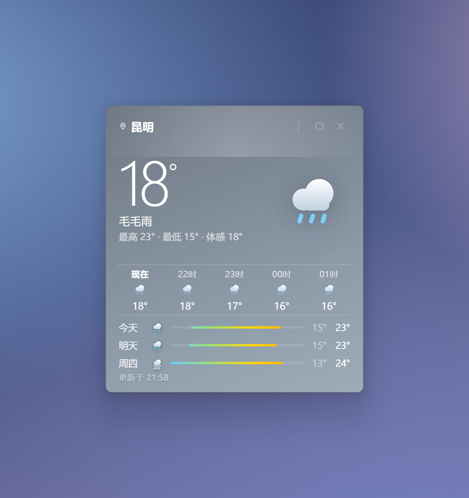

# 天气卡片 · WeatherCard

> 贴在 Windows 桌面上的天气小卡。自动定位，不抢焦点，不占任务栏，单文件免安装。



## 特性

- **真透明背景** —— 常驻桌面层时垫一张桌面快照（圆角外那圈显示的就是桌面本身），置顶模式直接走 per-pixel 真透明；不做模糊、不做磨砂，随时看得清桌面
- **自动定位** —— 不用选城市，启动就知道你在哪；三层降级：浏览器定位 → IP 归属 → 时区兜底
- **鼠标指哪浮哪** —— 卡片被别的窗口压住时，鼠标指上去（不用点）就临时浮到最前，移开自动沉回去；不影响你设的「窗口置顶」
- **拖窗口按卡片空白处** —— 按住卡上任意非交互区域就能拖（城市名、右上角按钮、搜索层除外）；拖动是程序自己实现的：主进程每 8ms 读系统光标直接挪窗口，因为系统标题栏拖动在桌面层（子窗口）下会慢半拍甚至不动。代价是没有 Aero Snap 贴边分屏
- **不打扰** —— 默认不置顶、不占任务栏、不抢焦点，就安静待在桌面上
- **可以缩放** —— 拖卡片四角等比缩放（70%~160%），整张卡一起放大（字、图标、间距同步变），记在存档里，下次启动还是这个大小
- **无边框圆角** —— 基准 320×380，拖动到任意位置并记住
- **数据零密钥** —— 天气与定位全部来自免费开放的 Open-Meteo / IP 归属接口，不需要注册任何 API Key
- **绿色免安装** —— 同时提供安装版（带开始菜单/桌面快捷方式）和单文件绿色版

## 下载安装

到 [Releases](../../releases) 页面下载：

| 文件 | 说明 |
| --- | --- |
| `WeatherCard-1.3.11-x64-setup.exe` | 安装版。可选安装目录，自动创建快捷方式「天气卡片」 |
| `WeatherCard-1.3.11-x64-portable.exe` | 绿色版。双击即用，不写注册表（除自启动选项） |

> 未做代码签名，Windows SmartScreen 可能提示"未知发布者"，点「更多信息 → 仍要运行」即可。

> **从旧版本升级**：首次启动会自动把之前版本记住的窗口位置、置顶状态搬过来，不用重新摆。

## 使用

| 操作 | 效果 |
| --- | --- |
| 拖动卡片 | 移动位置，松手后自动记住 |
| 双击卡片 | 立即刷新天气 |
| 单击城市名 | 打开城市搜索（留空则跟随自动定位）；支持中文、拼音全拼（kunming）、拼音首字母（km） |
| `F5` | 刷新 |
| 右键卡片 | 打开菜单：刷新 / 搜索城市 / 回到自动定位 / 桌面右键菜单显示 / 开机自启动 / 窗口置顶 / 退出 |
| 右上角 × | 关闭卡片（即退出应用） |

天气每 10 分钟自动刷新一次；定位结果缓存 30 分钟，超时会重新识别（手动选过的城市不会被覆盖）。

卡片中部那一条是指标栏，鼠标悬停可以看到原始数值：

| 指标 | 口径 |
| --- | --- |
| 空气 | **中国 AQI（HJ 633-2012）**，取 PM2.5 / PM10 / O₃ 各自 IAQI 的最大值。Open-Meteo 只给美国标准，直接显示会和国产天气 App 对不上，所以本地按国标重算 |
| 风 | 8 方位风向 + 蒲福风级（如「东南风 3 级」） |
| 紫外线 | **当前小时**的 UV 指数分级；夜间自然显示「弱」，今日峰值放在悬停提示里 |

### 桌面右键菜单

在卡片上右键勾选「桌面右键菜单显示」后，**桌面空白处右键**会多出一项「显示天气卡片」，点一下就启动（已在运行则直接唤出，不会开第二个）。

- 只写 `HKCU\Software\Classes\DesktopBackground\Shell\WeatherWidget`，不碰 HKLM、不需要管理员权限
- 卸载安装版时自动清理这一项；取消勾选也会删掉
- Windows 11 的桌面右键是新版精简菜单，这一项在「显示更多选项」（或按 `Shift`+`F10`）里

### 常驻桌面 / 所有窗口置顶

卡片**默认就贴在桌面层**（`Progman` 的子窗口），和桌面图标同层：按 `Win`+`D` 完全不动，有窗口盖住时自然被盖住 —— 这是桌面挂件该有的行为，不需要任何设置。

唯一的开关是右键菜单的「**所有窗口置顶（关掉就常驻桌面）**」：

| 状态 | 表现 |
| --- | --- |
| 不勾（默认） | 常驻桌面层。Win+D 不动，被窗口盖住时看不见 |
| 勾上 | 脱离桌面层，浮在所有窗口最前面 |

两者天然互斥（子窗口不能置顶），切换是**运行中直接完成**的，不会重启、不会闪。

### 卡片大小

**拖卡片右下角（或任一角）等比缩放**，范围 70%~160%，以卡片中心为锚点，超出屏幕会自动夹回来；大小记在存档里，重启保持。

实现方式是"窗口尺寸 × z + 页面 `zoomFactor` = z"，所以是**整张卡等比放大** —— 字号、图标、行距一起变，不会出现"框变大了、字还是原来那么小"。桌面层（子窗口）下同样有效。

> 为什么不直接开 `resizable`：卡片没有边框可抓，而且桌面层里窗口是 `Progman` 的子窗口，系统那套边框拖拽在子窗口下会慢半拍甚至不动。所以四个角的拖拽是程序自己实现的（主进程跟系统光标算尺寸）。

### 常驻桌面是怎么做的

桌面图标不是窗口，它们住在桌面窗口 `Progman` 内部，`Win`+`D` 只收顶层应用窗口，从不碰这棵树；想和它们同层只能 `SetParent` 进去。

卡片启动时把自己挂进 `Progman`，于是待遇和桌面快捷图标一样：**按 Win+D 完全不动**，也不会浮到别的窗口前面。

几个已知行为：

- **桌面层模式下系统材质（Acrylic）会自动关掉**（那层材质是画给顶层窗口的，挂进桌面后就没了，不关会变成一块灰底），改走透明自绘 + 桌面快照
- **多张卡都在桌面层时，鼠标指哪张、哪张就在前面**，移开不会沉下去（沉下去就等于掉进桌面图标层背后，看起来就是"卡片自己消失了"）
- **Explorer 重启会让卡片跟着消失**，重新打开即可
- 圆角在桌面层下靠"快照铺满整窗"实现（见下文），所以既没有黑角也没有硬裁的台阶

**搜索层怎么退出来**（v1.0.12 起）：桌面层里卡片拿不到键盘焦点、点桌面也不会让它失焦，ESC 和"点空白"这两条老出口都会失效。现在有三条路，任一条都能退：

1. 输入框右边那个 **✕**
2. 按 **ESC**（主进程替你盯着，40ms 轮一次）
3. **点窗口外面**（桌面或其他地方，同样由主进程判断光标本离开了窗口）

## 定位是怎么工作的

按可信度从高到低尝试，任一层成功即返回：

1. **系统定位**（Chromium geolocation，若系统定位服务开启）
2. **IP 归属**（主源 `ip.sb`、副源 `ipwho.is`，两源互相校验；时区与系统时区不一致的结果会被降权）
3. **默认城市**（北京），保证任何情况下都有内容显示

> 主进程用 Node 的 `fetch` 直接发请求，**不跟随 Windows 系统代理**。这是刻意的：机器上挂着代理/VPN 时，渲染进程的请求会走代理出口，IP 可能落到境外机房，定位就错到别的国家（开发期踩过这个坑，一度显示"伦敦"）。

## 背景是怎么实现的

**常驻桌面层（默认）：透明自绘 + 桌面快照**

窗口 `transparent: true`，卡片自己画渐变（浓度由外观面板的「透明度」控制）。桌面层里是 `Progman` 的子窗口，per-pixel alpha 不参与合成、alpha=0 的像素会渲染成黑色，所以半透明处必须垫一张桌面快照（`PrintWindow(Progman)` 抓壁纸+图标）—— 圆角外那圈显示的就是快照里的桌面本身，看起来和"真透明"一样，但没有黑角。

**所有窗口置顶：per-pixel 真透明**

脱离桌面层后窗口是顶层窗口，alpha 正常参与合成，直接透出背后真实的窗口内容 —— 不需要快照，圆角只由 `border-radius` 抗锯齿，边缘一定干净。

> 早期版本用过系统 `backgroundMaterial: "acrylic"`（Win11 22H2~23H2）。本机 build 26200 实测：acrylic 的窗口取像素永远是 `#d3d3d3`（固定兜底色、不是采样），而且这层材质由 DWM 画在**整个窗口矩形**上、`SetWindowRgn` 裁不掉，圆角外侧会露出 4 个方块。24H2 起系统材质已经退化，现在 24H2+ 直接走透明自绘。
>
> 「磨砂」（给快照加高斯模糊）这个功能已经移除 —— 桌面挂件要的是"看清桌面"，不是"隔着毛玻璃看"。

## 自己构建

```bash
git clone <repo-url>
cd weather-widget
npm install
npm start          # 开发运行
npm run dist       # 打包出 dist/ 下的 setup.exe 与 portable.exe
```

- 打包配置在 `package.json` 的 `build` 字段（NSIS + portable 双目标）
- 图标改完 `icon.png` 后跑 `npm run icon`，会生成多尺寸的 `icon.ico`
- 只构建解包目录（调试用）：`npm run dist:dir`

国内网络构建建议设镜像，否则 115MB 的 Electron 运行时会卡很久：

```bash
export ELECTRON_MIRROR="https://registry.npmmirror.com/-/binary/electron/"
export ELECTRON_BUILDER_BINARIES_MIRROR="https://registry.npmmirror.com/-/binary/electron-builder-binaries/"
```

> 构建踩坑备忘：winCodeSign 解压需要符号链接权限（否则 nsis 打包失败）；没有签名证书时设 `CSC_IDENTITY_AUTO_DISCOVERY=false` 免得卡在找证书上。

## 目录结构

```
weather-widget/
├── main.js            # 主进程：窗口、位置记忆、右键菜单、IP 归属查询、旧版本数据迁移
├── preload.js         # contextBridge 暴露的最小接口
├── widget.html        # 天气卡：全部界面与逻辑（单文件，无框架、无构建步骤）
├── icon.png / icon.ico
└── tools/
    ├── make-icon.py                # 多尺寸 ico 生成
    └── github-actions-build.yml    # 备用 CI（放到 .github/workflows/ 下才生效）
```

## 更新记录（1.0.4 → 1.3.11）

- **1.3.11**：菜单瘦身，只留真正能用的项
  - 删掉「卡片大小」子菜单 —— 拖四角就能缩放，菜单里那串档位是多余的
  - 删掉「刷新桌面背景」—— 背景会自己跟着桌面变（交互后 0.4 秒 + 20 秒兜底），手动入口用不上
  - 删掉「外观设置」里的「磨砂」滑杆和菜单文案里的"磨砂"字样（磨砂功能已整体移除）
- **1.3.10**：修掉删滑杆时漏改的 JS —— `$("lkFrost")` 变 null 会让整个外观面板提前 return，透明度调节跟着失效
- **1.3.9**：**磨砂彻底关掉**（`--frost` 强制 0）。之前把滑杆拉到 16px 的卡一直是糊的
- **1.3.8**：**置顶改成运行中直接切换**，不再重启（重启会闪一下）。页面通过 `wgt:dlayer` 跟着换模式
- **1.3.7 / 1.3.6**：**置顶模式不画桌面快照**，走 per-pixel 真透明 —— 压在别的窗口上时四角不再露出快照方块
- **1.3.4**：**「贴进桌面」不再是个选项**，默认常驻；只留「所有窗口置顶（关掉就常驻桌面）」。删掉全部全局快捷键（`Ctrl`+`Alt`+`2` / `↑` / `↓`），操作全走右键菜单
- **1.3.3**：**便携版重启修复** —— 裸 `app.relaunch()` 重跑的是 `%TEMP%` 里的临时副本，启动器一删目录就挂（表现：点菜单里任何"改完要重启"的项，卡片当场消失）。改用 `PORTABLE_EXECUTABLE_FILE`
- **1.3.2**：窗口置顶点了没反应 —— 运行中 `SetParent` 回来再置顶会和 DWM 抢状态
- **1.3.1**：一轮代码审查后的修复，六条都是能复现的行为错误
  - **「贴进桌面」改为默认开启**：不贴的话 `Win`+`D` 会把卡片一起收走（"卡片自己消失了"）。老用户显式存过 `false` 的仍保持原样，不被覆盖
  - **桌面层模式下圆角也是平滑的**：子窗口里 alpha=0 会变黑、`SetWindowRgn` 又是 1 位硬裁（有锯齿）。改成用 `#bd` 桌面快照铺满整窗，圆角外那圈就是"桌面本身"，由 `border-radius` 抗锯齿过渡；抓不到快照时自动退回硬裁保底
  - **四角露出 4 个方块材质**（用户截图报的"多余的直角"）：Win11 24H2 起 `backgroundMaterial:"acrylic"` 退化成纯色 `#d3d3d3`，而这层材质由 DWM 画在整个窗口矩形上、`SetWindowRgn` 裁不掉，18px 圆角外侧就露出方块；`DWMWCP_ROUND` 在无边框窗口上也不生效。改为 24H2 起走透明自绘 + 桌面快照，圆角精确、`磨砂`滑杆也终于生效（以前 acrylic 模式下 `#bd` 不创建，滑杆空转）
  - **窗口尺寸虚胖 44px**：`PAD=22` 号称"留给投影"，但 `.card` 是 `inset:0` 铺满窗口，根本没画投影，只是把卡片撑成 364×424。置 0 后两种模式都是 320×380
  - **底部「更新于」被裁**：`CARD_H=360` 时内容实测 378px，溢出 18px。改 380
  - **关不掉的进程**：桌面层模式下用过城市搜索后点 ×，幽灵输入窗（隐藏窗口）没销毁，`window-all-closed` 不触发，进程留在后台（任务栏看不见）→ 关卡片时一并 `destroy()`
  - **取消「窗口置顶」被塞进桌面层**：原来取消置顶会 `patchState({desktopLayer:true})` 并当场 `SetParent`，此时 acrylic 还开着 → 一块灰底。现在只撤置顶 + 沉底
  - **卡片飘在所有窗口前面**：`desktopIsShowing()` 的阈值 `apps <= 3` 改成 `apps === 0`。原来开着两三个窗口点一下桌面就被判成"正在显示桌面"，卡片被顶到最前
  - **日志无上限**：`win-events.log` 每 5 秒一条心跳（约 1.5 MB/天），现在统一走 `appendLog`，超 512 KB 自动清空
  - **定位缓存失效**：`readAuto/writeAuto` 是死代码，"缓存 30 分钟"从来没生效，每次冷启动都重跑定位 → 现在真的写进 localStorage
  - **中文城市名回填不到**：反向地理编码接口实测要 8 秒，超时却只给 2.5 秒，必然放弃 → 超时放到 9 秒，并且不再串在首屏路径上
  - 附带：AQI 的 O₃ 改用国标**1 小时平均**限值表（原来用的是 8 小时滑动平均那张，而输入是单小时瞬时值）；透明度滑杆 `min` 10→0（原来 alpha=1 显示成 10%，一碰滑杆卡片突然变透）；重复 `createWindow` 不再叠加定时器；`imeForceFocus` 不再每次聚焦都重新 dlopen；禁止导航/开新窗；修掉 `startRegionWatch` 里引用局部变量导致的 ReferenceError

- **1.1.0**：四角可拖拽缩放（等比，复用已有的 zoom 体系，缩放值存盘）；修圆角半径只算一半的问题——`CreateRoundRectRgn` 最后两个参数是椭圆长宽、半径 = 值/2，之前传 `rad` 导致窗口区域比卡片方，四角露出弧形缝

- **桌面快照不再周期性重抓**：原来每 20 秒无条件抓一次全屏（抓的时候卡片要隐藏 60~70ms），桌面上会看到卡片"闪一下"。改成按事件抓：换壁纸、改分辨率、在桌面上松开左键（60 秒最多一次），点应用窗口不抓
- **抓图时卡片隐藏时间缩短**：`PrintWindow` 返回后立刻显示，`GetDIBits` 移到显示之后
- **搜索框输入修复**：桌面层里聚焦搜索框时输入桥没被正确打开，导致打字进不去
- **卡片不再被裁掉一圈**：圆角裁剪（SetWindowRgn）原来按"窗口减 22px 投影边距"算，但卡片是铺满窗口的，实测四边各被切掉 22 CSS px、连左右文字都被切。改成按卡片真实范围裁，只保留圆角
- **preload 缺失不再白屏**：`window.wgt` 没注入时补一层空实现，最差退化成普通网页，而不是整页脚本抛错、卡片变成静态 HTML

## 已知限制

- 只在 Windows 上验证过。macOS / Linux 未测试（Acrylic 是 Windows 专有，其他平台会走半透明回退）
- 未做代码签名与自动更新
- 天气数据依赖 Open-Meteo 可用性；请求失败时保留上一次结果并标注"刷新失败"
- 高 DPI 缩放下窗口尺寸按逻辑像素计算，暂未做逐屏适配
- **挂代理 / VPN 时定位可能跑到境外**：IP 归属查的是出口 IP，时区对不上会在卡片右下角标「网络定位·可能不准」，点城市名可手动指定

## 数据来源

- 天气与空气质量：[Open-Meteo](https://open-meteo.com/)（CC BY 4.0）
- 城市搜索：Open-Meteo Geocoding API
- 反向地理编码（系统定位 → 城市名）：[BigDataCloud](https://www.bigdatacloud.com/)（`api-bdc.io`）
- IP 归属：[ip.sb](https://ip.sb/) / [ipwho.is](https://ipwho.is/)
- AQI 分级口径：中国《环境空气质量指数（AQI）技术规定》HJ 633-2012，本地换算，不依赖第三方服务

## License

[MIT](LICENSE)
