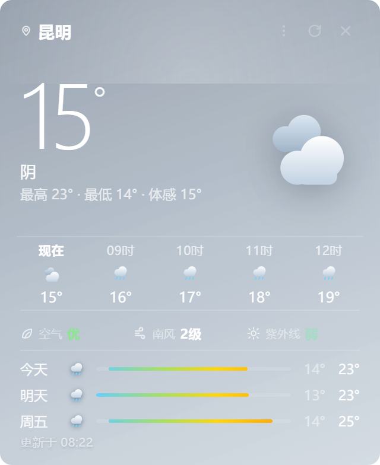

# 天气卡片 · WeatherCard

> 贴在 Windows 桌面上的磨砂玻璃天气小卡。自动定位，不抢焦点，不占任务栏。
> 本项目原是「桌面卡片套件」（天气 + 待办合体，1.9.1 为最后合体版），现已拆分为天气 / 待办 / 倒计时三个独立应用，各自发布。



## 特性

- **真·磨砂玻璃** —— Win11 22H2~23H2 走系统 Acrylic 实时模糊；24H2 起（系统材质已退化）改走桌面快照 + 高斯模糊，观感一致、圆角干净，详见下文「磨砂是怎么实现的」
- **自动定位** —— 不用选城市，启动就知道你在哪；三层降级：浏览器定位 → IP 归属 → 时区兜底
- **鼠标指哪浮哪** —— 卡片被别的窗口压住时，鼠标指上去（不用点）就临时浮到最前，移开自动沉回去；不影响你设的「窗口置顶」
- **拖窗口按卡片空白处** —— 按住卡上任意非交互区域就能拖（城市名、右上角按钮、搜索层除外）；拖动是程序自己实现的：主进程每 8ms 读系统光标直接挪窗口，因为系统标题栏拖动在桌面层（子窗口）下会慢半拍甚至不动。代价是没有 Aero Snap 贴边分屏
- **不打扰** —— 默认不置顶、不占任务栏、不抢焦点，就安静待在桌面上
- **可以缩放** —— 右键菜单「卡片大小」选 70%~150%，或按 `Ctrl+Alt+↑` / `Ctrl+Alt+↓` 每档 5% 微调；整张卡等比放大（字、图标、间距一起变），记在存档里，下次启动还是这个大小
- **无边框圆角** —— 基准 320×380，拖动到任意位置并记住
- **数据零密钥** —— 天气与定位全部来自免费开放的 Open-Meteo / IP 归属接口，不需要注册任何 API Key
- **绿色免安装** —— 同时提供安装版（带开始菜单/桌面快捷方式）和单文件绿色版

## 下载安装

到 [Releases](../../releases) 页面下载：

| 文件 | 说明 |
| --- | --- |
| `WeatherCard-1.3.1-x64-setup.exe` | 安装版。可选安装目录，自动创建快捷方式「天气卡片」 |
| `WeatherCard-1.3.1-x64-portable.exe` | 绿色版。双击即用，不写注册表（除自启动选项） |

> 未做代码签名，Windows SmartScreen 可能提示"未知发布者"，点「更多信息 → 仍要运行」即可。

> **从合体版升级**：首次启动会自动把合体版（1.9.1 及以前）记住的窗口位置、置顶状态搬过来，不用重新摆。

## 使用

| 操作 | 效果 |
| --- | --- |
| 拖动卡片 | 移动位置，松手后自动记住 |
| 双击卡片 | 立即刷新天气 |
| 单击城市名 | 打开城市搜索（留空则跟随自动定位）；支持中文、拼音全拼（kunming）、拼音首字母（km） |
| `F5` | 刷新 |
| 右键卡片 | 打开菜单：刷新 / 搜索城市 / 回到自动定位 / 桌面右键菜单显示 / 开机自启动 / 窗口置顶 / 退出 |
| 右上角 × | 关闭卡片（即退出应用） |

天气每 10 分钟自动刷新一次；定位结果缓存 30 分钟，超时会重新识别（手动选过的城市不会被覆盖）。

卡片中部那一条是指标栏，鼠标悬停可以看到原始数值：

| 指标 | 口径 |
| --- | --- |
| 空气 | **中国 AQI（HJ 633-2012）**，取 PM2.5 / PM10 / O₃ 各自 IAQI 的最大值。Open-Meteo 只给美国标准，直接显示会和国产天气 App 对不上，所以本地按国标重算 |
| 风 | 8 方位风向 + 蒲福风级（如「东南风 3 级」） |
| 紫外线 | **当前小时**的 UV 指数分级；夜间自然显示「弱」，今日峰值放在悬停提示里 |

### 桌面右键菜单

在卡片上右键勾选「桌面右键菜单显示」后，**桌面空白处右键**会多出一项「显示天气卡片」，点一下就启动（已在运行则直接唤出，不会开第二个）。

- 只写 `HKCU\Software\Classes\DesktopBackground\Shell\WeatherWidget`，不碰 HKLM、不需要管理员权限
- 卸载安装版时自动清理这一项；取消勾选也会删掉
- Windows 11 的桌面右键是新版精简菜单，这一项在「显示更多选项」（或按 `Shift`+`F10`）里

### 关于"窗口置顶"

默认**不置顶**——卡片待在普通窗口层，切到别的程序时不会浮在最前面。如果你希望它一直在最上层，右键菜单勾选「窗口置顶」即可。

### 卡片大小（v1.0.11 起）

三个入口，随便用哪个：

| 入口 | 步长 |
| --- | --- |
| 右键菜单 →「卡片大小」 | 固定档位：70% / 80% / 90% / 100% / 115% / 130% / 150% |
| `Ctrl` + `Alt` + `↑` / `↓` | 5% 一档（全局生效，卡片没焦点也能按） |
| `Ctrl` + 滚轮 | 5% 一档（**只在普通窗口模式下有效**，见下） |

范围 70%~160%，以**卡片中心**为锚点缩放，超出屏幕会自动夹回来；大小记在存档里，重启保持。

实现方式是"窗口尺寸 × z + 页面 `zoomFactor` = z"，所以是**整张卡等比放大**——字号、图标、行距一起变，不会出现"框变大了、字还是原来那么小"。缩放这一下改的是原生窗口尺寸，桌面层（子窗口）下同样有效，已实测。

> 为什么滚轮在桌面层下失效：Windows 只把 `WM_MOUSEWHEEL` 投给**拥有焦点**的窗口，而贴进桌面的卡片是 `Progman` 的子窗口，拿不到焦点，滚轮消息根本到不了它。快捷键和菜单不依赖焦点，所以它们是主入口。

### 贴进桌面（和桌面图标同一层，v1.0.8 起，**1.3.1 起默认开启**）

> 为什么不贴不行：不贴进桌面的话，按 `Win`+`D`「显示桌面」会把卡片和其他窗口一起收走 —— 表现就是"卡片自己消失了"。贴进 Progman 之后它和桌面图标同层，`Win`+`D` 完全不动。
>
> 想改回去：右键菜单取消勾选「贴进桌面（和桌面图标同层）」，或者按 `Ctrl`+`Alt`+`2`（会重启卡片一次）。

右键菜单勾选「**贴进桌面（和桌面图标同层）**」后，卡片变成桌面窗口的子窗口，待遇和桌面快捷图标一样：**按 Win+D 完全不动**，也不会浮到别的窗口前面。切回来按 `Ctrl`+`Alt`+`2`（看不见窗口时同样有效）。

原理：桌面图标不是窗口，它们住在桌面窗口 `Progman` 内部，Win+D 只收顶层应用窗口，从不碰这棵树；想同层只能 `SetParent` 进去。

注意：**桌面层模式下系统磨砂（Acrylic）会自动关掉**（那层材质是画给顶层窗口的，挂进桌面后就没了，不关会变成一块灰底），改用半透明自绘 + 投影；**两张卡都在桌面层时，鼠标指哪张、哪张就在前面**，移开不会沉下去（沉下去就等于掉进桌面图标层背后，看起来就是"卡片自己消失了"）；Explorer 重启会让卡片跟着消失，重新打开即可；切换会重启卡片一次。

**搜索层怎么退出来**（v1.0.12 起）：桌面层里卡片拿不到键盘焦点、点桌面也不会让它失焦，ESC 和"点空白"这两条老出口都会失效。现在有三条路，任一条都能退：

1. 输入框右边那个 **✕**
2. 按 **ESC**（主进程替你盯着，40ms 轮一次）
3. **点窗口外面**（桌面或其他地方，同样由主进程判断光标本离开了窗口）

## 定位是怎么工作的

按可信度从高到低尝试，任一层成功即返回：

1. **系统定位**（Chromium geolocation，若系统定位服务开启）
2. **IP 归属**（主源 `ip.sb`、副源 `ipwho.is`，两源互相校验；时区与系统时区不一致的结果会被降权）
3. **默认城市**（北京），保证任何情况下都有内容显示

> 主进程用 Node 的 `fetch` 直接发请求，**不跟随 Windows 系统代理**。这是刻意的：机器上挂着代理/VPN 时，渲染进程的请求会走代理出口，IP 可能落到境外机房，定位就错到别的国家（开发期踩过这个坑，一度显示"伦敦"）。

## 磨砂是怎么实现的

> **1.3.1 起有变化，原因写在下面「为什么不再默认用 Acrylic」里。**

**默认（Win11 24H2 及以后 / 非 Win11）：透明自绘 + 桌面快照**
窗口 `transparent: true`，卡片自己画玻璃渐变（浓度由外观面板的「透明度」控制）；半透明处垫一张桌面快照（`PrintWindow(Progman)` 抓壁纸+图标），「磨砂」滑杆就是给这张快照加 `blur()`。圆角由 `SetWindowRgn` 把窗口裁成 18px 圆角矩形，四角真正透明。

**Windows 11 22H2 ~ 23H2（build 22621 ~ 26099）：系统 Acrylic**
用 Electron 的 `backgroundMaterial: "acrylic"`，由桌面窗口管理器实时合成模糊。此模式下卡片背景必须全透明，否则会盖住系统磨砂层；主进程通过 `additionalArguments` 把 `--wgt-acrylic=1|0` 透给渲染进程，页面据此加 `body.acrylic` 或 `body.solid`。

**为什么不再默认用 Acrylic（24H2 起）**
本机 build 26200 实测：`backgroundMaterial: "acrylic"` 的窗口，无论背后是海滩壁纸还是纯白网页，取像素永远是 `#d3d3d3` —— 是固定兜底色、不是采样（同一次测试里 `mica` / `tabbed` 还能拿到接近背景的浅色，只有 acrylic 死了）。

更麻烦的是这层材质由 DWM 直接画在**整个窗口矩形**上，`SetWindowRgn` 裁不掉它，于是 18px 圆角外侧会露出 4 个方块材质；`DwmSetWindowAttribute(DWMWA_WINDOW_CORNER_PREFERENCE, DWMWCP_ROUND)` 在无边框窗口上返回成功但也不生效。三条路都试过，只剩"不用系统材质"这一条。

再加上桌面挂件 99% 的时间不是活动窗口，Windows 本来就会把材质降级成纯色 —— 这条路对这个使用场景本来就是错的。

副作用（好的那种）：以前 acrylic 模式下 `#bd` 快照层压根不创建，外观面板的「磨砂」滑杆是空转的；现在两种模式统一走快照，滑杆真的有效。

## 自己构建

```bash
git clone <repo-url>
cd weather-widget
npm install
npm start          # 开发运行
npm run dist       # 打包出 dist/ 下的 setup.exe 与 portable.exe
```

- 打包配置在 `package.json` 的 `build` 字段（NSIS + portable 双目标）
- 图标改完 `icon.png` 后跑 `npm run icon`，会生成多尺寸的 `icon.ico`
- 只构建解包目录（调试用）：`npm run dist:dir`

国内网络构建建议设镜像，否则 115MB 的 Electron 运行时会卡很久：

```bash
export ELECTRON_MIRROR="https://registry.npmmirror.com/-/binary/electron/"
export ELECTRON_BUILDER_BINARIES_MIRROR="https://registry.npmmirror.com/-/binary/electron-builder-binaries/"
```

> 构建踩坑备忘：winCodeSign 解压需要符号链接权限（否则 nsis 打包失败）；没有签名证书时设 `CSC_IDENTITY_AUTO_DISCOVERY=false` 免得卡在找证书上。

## 目录结构

```
weather-widget/
├── main.js            # 主进程：窗口、Acrylic、位置记忆、右键菜单、IP 归属查询、合体版数据迁移
├── preload.js         # contextBridge 暴露的最小接口
├── widget.html        # 天气卡：全部界面与逻辑（单文件，无框架、无构建步骤）
├── icon.png / icon.ico
└── tools/
    ├── make-icon.py                # 多尺寸 ico 生成
    └── github-actions-build.yml    # 备用 CI（放到 .github/workflows/ 下才生效）
```

## 更新记录（1.0.4 → 1.3.1）

- **1.3.1**：一轮代码审查后的修复，六条都是能复现的行为错误
  - **「贴进桌面」改为默认开启**：不贴的话 `Win`+`D` 会把卡片一起收走（"卡片自己消失了"）。老用户显式存过 `false` 的仍保持原样，不被覆盖
  - **桌面层模式下圆角也是平滑的**：子窗口里 alpha=0 会变黑、`SetWindowRgn` 又是 1 位硬裁（有锯齿）。改成用 `#bd` 桌面快照铺满整窗，圆角外那圈就是"桌面本身"，由 `border-radius` 抗锯齿过渡；抓不到快照时自动退回硬裁保底
  - **四角露出 4 个方块材质**（用户截图报的"多余的直角"）：Win11 24H2 起 `backgroundMaterial:"acrylic"` 退化成纯色 `#d3d3d3`，而这层材质由 DWM 画在整个窗口矩形上、`SetWindowRgn` 裁不掉，18px 圆角外侧就露出方块；`DWMWCP_ROUND` 在无边框窗口上也不生效。改为 24H2 起走透明自绘 + 桌面快照，圆角精确、`磨砂`滑杆也终于生效（以前 acrylic 模式下 `#bd` 不创建，滑杆空转）
  - **窗口尺寸虚胖 44px**：`PAD=22` 号称"留给投影"，但 `.card` 是 `inset:0` 铺满窗口，根本没画投影，只是把卡片撑成 364×424。置 0 后两种模式都是 320×380
  - **底部「更新于」被裁**：`CARD_H=360` 时内容实测 378px，溢出 18px。改 380
  - **关不掉的进程**：桌面层模式下用过城市搜索后点 ×，幽灵输入窗（隐藏窗口）没销毁，`window-all-closed` 不触发，进程留在后台（任务栏看不见）→ 关卡片时一并 `destroy()`
  - **取消「窗口置顶」被塞进桌面层**：原来取消置顶会 `patchState({desktopLayer:true})` 并当场 `SetParent`，此时 acrylic 还开着 → 一块灰底。现在只撤置顶 + 沉底
  - **卡片飘在所有窗口前面**：`desktopIsShowing()` 的阈值 `apps <= 3` 改成 `apps === 0`。原来开着两三个窗口点一下桌面就被判成"正在显示桌面"，卡片被顶到最前
  - **日志无上限**：`win-events.log` 每 5 秒一条心跳（约 1.5 MB/天），现在统一走 `appendLog`，超 512 KB 自动清空
  - **定位缓存失效**：`readAuto/writeAuto` 是死代码，"缓存 30 分钟"从来没生效，每次冷启动都重跑定位 → 现在真的写进 localStorage
  - **中文城市名回填不到**：反向地理编码接口实测要 8 秒，超时却只给 2.5 秒，必然放弃 → 超时放到 9 秒，并且不再串在首屏路径上
  - 附带：AQI 的 O₃ 改用国标**1 小时平均**限值表（原来用的是 8 小时滑动平均那张，而输入是单小时瞬时值）；透明度滑杆 `min` 10→0（原来 alpha=1 显示成 10%，一碰滑杆卡片突然变透）；重复 `createWindow` 不再叠加定时器；`imeForceFocus` 不再每次聚焦都重新 dlopen；禁止导航/开新窗；修掉 `startRegionWatch` 里引用局部变量导致的 ReferenceError

- **1.1.0**：四角可拖拽缩放（等比，复用已有的 zoom 体系，缩放值存盘）；修圆角半径只算一半的问题——`CreateRoundRectRgn` 最后两个参数是椭圆长宽、半径 = 值/2，之前传 `rad` 导致窗口区域比卡片方，四角露出弧形缝

- **桌面快照不再周期性重抓**：原来每 20 秒无条件抓一次全屏（抓的时候卡片要隐藏 60~70ms），桌面上会看到卡片"闪一下"。改成按事件抓：换壁纸、改分辨率、在桌面上松开左键（60 秒最多一次），点应用窗口不抓
- **抓图时卡片隐藏时间缩短**：`PrintWindow` 返回后立刻显示，`GetDIBits` 移到显示之后
- **搜索框输入修复**：桌面层里聚焦搜索框时输入桥没被正确打开，导致打字进不去
- **卡片不再被裁掉一圈**：圆角裁剪（SetWindowRgn）原来按"窗口减 22px 投影边距"算，但卡片是铺满窗口的，实测四边各被切掉 22 CSS px、连左右文字都被切。改成按卡片真实范围裁，只保留圆角
- **preload 缺失不再白屏**：`window.wgt` 没注入时补一层空实现，最差退化成普通网页，而不是整页脚本抛错、卡片变成静态 HTML

## 已知限制

- 只在 Windows 上验证过。macOS / Linux 未测试（Acrylic 是 Windows 专有，其他平台会走半透明回退）
- 未做代码签名与自动更新
- 天气数据依赖 Open-Meteo 可用性；请求失败时保留上一次结果并标注"刷新失败"
- 高 DPI 缩放下窗口尺寸按逻辑像素计算，暂未做逐屏适配
- **挂代理 / VPN 时定位可能跑到境外**：IP 归属查的是出口 IP，时区对不上会在卡片右下角标「网络定位·可能不准」，点城市名可手动指定

## 数据来源

- 天气与空气质量：[Open-Meteo](https://open-meteo.com/)（CC BY 4.0）
- 城市搜索：Open-Meteo Geocoding API
- 反向地理编码（系统定位 → 城市名）：[BigDataCloud](https://www.bigdatacloud.com/)（`api-bdc.io`）
- IP 归属：[ip.sb](https://ip.sb/) / [ipwho.is](https://ipwho.is/)
- AQI 分级口径：中国《环境空气质量指数（AQI）技术规定》HJ 633-2012，本地换算，不依赖第三方服务

## License

[MIT](LICENSE)
