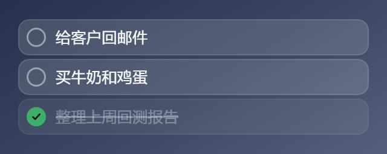
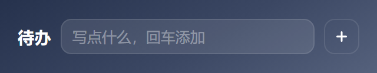
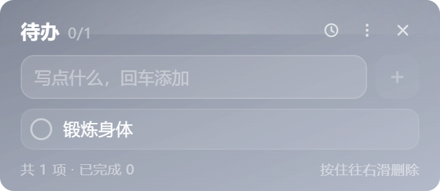
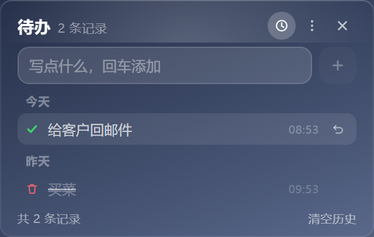

# 桌面卡片套件 · Weather & Todo Widget

> 两张贴在 Windows 桌面上的磨砂玻璃卡片：一张看天气，一张记待办。自动定位，不抢焦点，不占任务栏。


## 特性

- **真·磨砂玻璃** —— 走 Windows 11 原生 Acrylic 材质，实时模糊窗口背后的桌面内容（不是简单调低透明度）
- **自动定位** —— 不用选城市，启动就知道你在哪；三层降级：浏览器定位 → IP 归属 → 时区兜底
- **两张卡片，各自独立** —— 天气卡和待办卡是独立窗口，可以分别拖动、分别置顶、分别关闭，互不干扰
- **待办卡片** —— 打字回车就记下；点圆圈标记完成（划掉 + 变浅，但**保留在原位**）；鼠标悬停出垃圾桶，按住往右滑也能删；卡片会随条目多少自动长高缩矮
- **平时只剩条目** —— 待办卡平时只显示待办本身：标题、历史/更多/关闭、输入框、底部统计全部收起，卡片真的变矮；鼠标移进卡片才展开，且展开时条目在屏幕上一动不动
- **连卡片底都没有** —— 收起时卡片背景、内高光、叠加色全部撤掉，窗口是真透明的，桌面上只剩几个圆角任务框；鼠标移进才长出卡片底色来托住顶栏和输入条
- **一条都没有时也是一行** —— 空列表不再是"还没有待办"的占位文案，而是把输入框本身摆成一条待办：`待办 + 写点什么 + ＋`，高度和一条待办完全一致，敲回车加第一条时窗口纹丝不动；**＋ 永远钉在最右端**，鼠标进来时三个图标出现在它左边，＋ 一个像素都不挪（不然打完字想点 ＋ 会点个空）
- **几条就多高** —— 窗口高度严格跟着条数走：1 条最矮，每多一条 +33px，删一条立刻缩回，不预留空位
- **打字完挪开就自动记下** —— 不用记得按回车：鼠标一离开卡片（0.3 秒内回来不算），输入框里的话就自己变成一条待办
- **双击就能改字** —— 写错了直接双击那条的文字，就地改；`Enter` 或点别处保存，`Esc` 反悔
- **鼠标指哪张哪张浮上来** —— 两张卡互相遮住时，鼠标指上去（不用点）就临时浮到最前，移开自动沉回去；不影响你设的「窗口置顶」
- **鼠标在框里就不会自己收** —— 收起只看一件事：系统光标有没有真的离开窗口矩形。展开时窗口会向上长 63px，这时候浏览器会自己误判一次"鼠标走了"，以前就被它带着缩回去（连临时置顶一起撤掉，卡片沉到别的窗口后面）；现在那声误报不算数
- **拖窗口按顶栏** —— 顶栏就是这张卡的标题栏，按住它拖跟资源管理器一样；任务框不变抓手、不会抬起变形，还是老老实实给你点、给你双击
- **任何背景上都读得清** —— 卡片透明，但每个任务框/输入框自带一层深色玻璃，摆在白底的行情软件或 Word 前面也不会"看不见"
- **历史记录** —— 顶栏时钟图标进入历史视图，按今天/昨天/更早分组，看得到什么时候完成了什么、删掉了什么，误删可一键放回
- **不打扰** —— 默认不置顶、不占任务栏、不抢焦点，就安静待在桌面上
- **无边框圆角** —— 天气卡 320×392、待办卡 320 宽按内容自适应高度，拖动到任意位置并记住
- **数据零密钥** —— 天气与定位全部来自免费开放的 Open-Meteo / IP 归属接口，不需要注册任何 API Key
- **绿色免安装** —— 同时提供安装版（带开始菜单/桌面快捷方式）和单文件绿色版

## 下载安装

到 [Releases](../../releases) 页面下载：

| 文件 | 说明 |
| --- | --- |
| `WeatherWidget-1.8.1-x64-setup.exe` | 安装版。可选安装目录，自动创建快捷方式 |
| `WeatherWidget-1.8.1-x64-portable.exe` | 绿色版。双击即用，不写注册表（除自启动选项） |

> 未做代码签名，Windows SmartScreen 可能提示"未知发布者"，点「更多信息 → 仍要运行」即可。

## 使用

### 天气卡片

| 操作 | 效果 |
| --- | --- |
| 拖动卡片 | 移动位置，松手后自动记住 |
| 双击卡片 | 立即刷新天气 |
| 单击城市名 | 打开城市搜索（留空则跟随自动定位） |
| `F5` | 刷新 |
| 右键卡片 | 打开菜单：刷新 / 搜索城市 / 回到自动定位 / 显示待办卡片 / 桌面右键菜单显示 / 开机自启动 / 窗口置顶 / 退出 |
| 右上角 × | 关闭这张卡片 |

天气每 10 分钟自动刷新一次；定位结果缓存 30 分钟，超时会重新识别（手动选过的城市不会被覆盖）。

卡片中部那一条是指标栏，鼠标悬停可以看到原始数值：

| 指标 | 口径 |
| --- | --- |
| 空气 | **中国 AQI（HJ 633-2012）**，取 PM2.5 / PM10 / O₃ 各自 IAQI 的最大值。Open-Meteo 只给美国标准，直接显示会和国产天气 App 对不上，所以本地按国标重算 |
| 风 | 8 方位风向 + 蒲福风级（如「东南风 3 级」） |
| 紫外线 | **当前小时**的 UV 指数分级；夜间自然显示「弱」，今日峰值放在悬停提示里 |

### 待办卡片

平时只有条目（鼠标不在卡上，卡片背景本身也不画，桌面直接透出来）：



一条都没有时，整张卡就是那一行输入框：



鼠标移上去展开：



| 操作 | 效果 |
| --- | --- |
| 鼠标移进卡片 | 整张卡展开：标题、历史/更多/关闭、输入框、底部统计出现（窗口向上长，条目不动）；**光标真的离开窗口**才收回，只剩条目。同时这张卡会临时浮到最前面 |
| **按住顶栏拖** | 顶栏就是标题栏：按住「待办 0/2」那一行拖，整张卡跟着走，松手自动记住位置；光标全程是箭头，任务框不抬起、不变形 |
| 输入文字 + `Enter` | 添加一条 |
| **输入完直接把鼠标挪开** | 有内容就自动加进去（挪开 0.3 秒内又回来则不算，可以接着打） |
| **双击某条的文字** | 就地改成别的字：`Enter` 或点别处保存，`Esc` 反悔；清空后回车视为放弃，不会把条目删掉 |
| 点左边圆圈 | 标记完成：文字划掉、整条变浅，**位置不动**（不会跳到底部） |
| 再点一次圆圈 | 取消完成 |
| 鼠标移到某条上 | 右侧浮出垃圾桶，点它删除 |
| 按住条目往右滑 | 滑过约 1/3 卡宽松手即删除；不到阈值会自动弹回 |
| 点顶栏时钟图标 | 切到历史记录视图，再点一次切回 |
| 历史里悬停某条 | 右侧浮出「↺ 放回待办」 |
| 页脚「清空历史」 | 清掉全部历史（不影响待办本身） |
| 右键卡片 | 菜单：添加待办 / 历史记录 / 清除已完成 / 显示天气卡片 / 窗口置顶 / 退出 |
| `Ctrl`+`N` | 光标跳到输入框 |

**鼠标指哪张，哪张就浮上来**：两张卡各是一个窗口，谁在上面由系统决定 —— 把天气卡拖到待办卡身上，待办就被压住了。现在鼠标**只是指上去、不用点**，这张卡会临时浮到最前；移开后乖乖沉回原位。临时抬升不写进设置，你在菜单里勾的「窗口置顶」不会被它改掉；右键菜单开着时也不会突然沉下去。

**整张卡都能拖**：任务框本身可以按住拖（`cursor` 是抓手）。上下拖、往左拖都是挪窗口；往右拖仍然是右滑删除 —— 那个手势从 v1.0 就在，不能让拖动把它抢走。想往右平移就先按住停一下（约 0.26 秒，框会微微抬起），之后任意方向都能拖。卡片四周的透明边距也照旧能直接拖。

**平时只留条目**：标题、历史/更多/关闭、输入框、底部统计默认全部收起（不是变透明，是真的收起来），卡片高度只等于待办条数；**卡片自己的底色、内高光、叠加色也一并撤掉**，窗口是真透明的，桌面上只剩几个圆角任务框。鼠标移进卡片才展开，此时窗口会向上长高 63px、底边补 14px，**待办条目在屏幕上的位置完全不动**，所以鼠标底下那一行不会跑。一条都没有时改走"单行"版式（上图），不会为了露出输入框而把整卡展开 —— 那反而会把鼠标底下的行弹走。

**每个控件自带一层深色玻璃**：卡片本身没有背景，但任务框、输入框、加号各自铺了一层半透明深底 + 1px 亮边。这样不论背后是深色壁纸还是白底窗口（行情软件、Word），白字都读得出来 —— 早先只做半透明白底，摆在白窗口前面整条会"消失"，看着像没添加上。

**卡片高度就等于内容**：1 条待办时最矮，收起态就是 62px（一条的高度），鼠标移上去展开到 139px；**每多一条正好长 33px**，少一条就缩回去；最多长到屏幕可用高度的 72%（再多的条目在卡片内部滚动）。空列表时也是 62px（一行输入框），不会先占好三行的位置。如果卡片贴着屏幕底部，长高时会向上伸展、底边固定；条目减少后自动缩回你原来摆的位置。

**删除和完成都会留痕**：历史记录保留最近 120 条，按「今天 / 昨天 / 具体日期」分组，标出完成时间。删错了可以放回待办（一律回到未完成状态，免得立刻被「清除已完成」清走）。



数据存在渲染进程的 `localStorage` 里（待办 `todo_v1`、历史 `todo_hist_v1`），完全离线，不上传任何地方。滚动条自动隐藏。

> 默认只开天气卡片。在天气卡片右键菜单里勾选「显示待办卡片」即可唤出，之后程序会记住这个状态。

### 桌面右键菜单

在卡片上右键勾选「桌面右键菜单显示」后，**桌面空白处右键**会多出一项「显示天气卡片」，点一下就启动（已在运行则直接唤出，不会开第二个）。

- 只写 `HKCU\Software\Classes\DesktopBackground\Shell`，不碰 HKLM、不需要管理员权限
- 卸载安装版时自动清理这一项；取消勾选也会删掉
- Windows 11 的桌面右键是新版精简菜单，这一项在「显示更多选项」（或按 `Shift`+`F10`）里

### 关于"窗口置顶"

默认**不置顶**——卡片待在普通窗口层，切到别的程序时不会浮在最前面。如果你希望它一直在最上层，右键菜单勾选「窗口置顶」即可。

## 定位是怎么工作的

按可信度从高到低尝试，任一层成功即返回：

1. **系统定位**（Chromium geolocation，若系统定位服务开启）
2. **IP 归属**（主源 `ip.sb`、副源 `ipwho.is`，两源互相校验；时区与系统时区不一致的结果会被降权）
3. **默认城市**（北京），保证任何情况下都有内容显示

> 主进程用 Node 的 `fetch` 直接发请求，**不跟随 Windows 系统代理**。这是刻意的：机器上挂着代理/VPN 时，渲染进程的请求会走代理出口，IP 可能落到境外机房，定位就错到别的国家（开发期踩过这个坑，一度显示"伦敦"）。

## 磨砂是怎么实现的

Windows 11 22H2（build ≥ 22621）上使用 Electron 的 `backgroundMaterial: "acrylic"`，由桌面窗口管理器实时合成模糊，截图/录屏里的模糊也是真实的。

低于该版本的系统自动退回"半透明渐变"模式（窗口 `transparent: true` + 卡片自身的玻璃渐变），观感接近但没有真实模糊。

**待办卡不走磨砂**，因为它是透明窗口：系统 Acrylic 材质会铺满整个窗口矩形，页面再怎么透明也会被那层糊住，做不到"只剩几个任务框"。所以两张卡各自决定材质（`CARD_ACRYLIC`）——天气卡照旧用 Acrylic，待办卡用 `transparent: true` + 页面自绘背景，展开时画渐变卡片、收起时什么都不画。

Acrylic 模式下卡片背景必须全透明，否则会盖住系统磨砂层。主进程通过 `additionalArguments` 把 `--wgt-acrylic=1|0` 透给渲染进程，页面据此加 `body.acrylic` 或 `body.solid`。待办窗口的透明边距固定为 0（`PAD`），否则鼠标还在卡片外面卡片就弹开了 —— 它靠"鼠标碰到"来触发展开。

## 自己构建

```bash
git clone <repo-url>
cd weather-widget
npm install
npm start          # 开发运行
npm run dist       # 打包出 dist/ 下的 setup.exe 与 portable.exe
```

- 打包配置在 `package.json` 的 `build` 字段（NSIS + portable 双目标）
- 图标改完 `icon.png` 后跑 `npm run icon`（需要 ffmpeg），会生成 16/24/32/48/64/128/256 七种尺寸的 `icon.ico`；只有 256 单尺寸的话，任务栏小图标会发虚
- 只构建解包目录（调试用）：`npm run dist:dir`

### 构建踩坑：winCodeSign 解压失败

如果构建停在下载 `winCodeSign-2.6.0.7z` 之后，并报：

```
ERROR: Cannot create symbolic link : 客户端没有所需的特权 :
  ...\Cache\winCodeSign\<随机数>\darwin\10.12\lib\libcrypto.dylib
```

原因是这个包里含两个 **macOS** 的 `.dylib` 符号链接，解压时 7za 带 `-snld` 要真实创建符号链接；未开启「开发者模式」或非管理员账户没有这个权限，于是整包解压失败、构建中断。Windows 侧完全用不到那两个文件。

绕过办法（实测可用）：跳过 electron-builder 的资源编辑，自己用 rcedit 写图标和版本信息，再用 `--prepackaged` 出安装包。

```bash
# 0) 手动解压 winCodeSign 到固定目录（符号链接报错可忽略，其余文件都已就位）
mkdir -p "$LOCALAPPDATA/electron-builder/Cache/winCodeSign-vendor"
node_modules/7zip-bin/win/x64/7za.exe x -y winCodeSign-2.6.0.7z \
  "-o$LOCALAPPDATA/electron-builder/Cache/winCodeSign-vendor"

# 1) 只解包，不碰资源
npx electron-builder --win --dir -c.win.signAndEditExecutable=false

# 2) 自己写图标 + 版本信息（rcedit 就在上面解出来的目录里）
"$LOCALAPPDATA/electron-builder/Cache/winCodeSign-vendor/rcedit-x64.exe" \
  dist/win-unpacked/WeatherWidget.exe --set-icon icon.ico \
  --set-version-string ProductName "天气卡片" \
  --set-version-string FileDescription "桌面天气卡片" \
  --set-file-version "1.2.0.0" --set-product-version "1.2.0"

# 3) 用现成的解包目录出安装包
npx electron-builder --win nsis portable --prepackaged dist/win-unpacked
```

CI（GitHub Actions 的 Windows runner）通常自带该权限，`npm run dist` 可以直接跑通。

国内网络构建建议设镜像，否则 115MB 的 Electron 运行时会卡很久：

```bash
export ELECTRON_MIRROR="https://registry.npmmirror.com/-/binary/electron/"
export ELECTRON_BUILDER_BINARIES_MIRROR="https://registry.npmmirror.com/-/binary/electron-builder-binaries/"
```


## 目录结构

```
weather-widget/
├── main.js            # 主进程：双卡片窗口、Acrylic、位置记忆、右键菜单、IP 归属查询
├── preload.js         # contextBridge 暴露的最小接口
├── widget.html        # 天气卡：全部界面与逻辑（单文件，无框架、无构建步骤）
├── todo.html          # 待办卡：同上，含右滑删除手势
├── icon.png / icon.ico
└── tools/make-icon.py # 多尺寸 ico 生成
```

## 已知限制

- 只在 Windows 上验证过。macOS / Linux 未测试（Acrylic 是 Windows 专有，其他平台会走半透明回退）
- 未做代码签名与自动更新
- 天气数据依赖 Open-Meteo 可用性；请求失败时保留上一次结果并标注"刷新失败"
- 高 DPI 缩放下窗口尺寸按逻辑像素计算，暂未做逐屏适配
- **挂代理 / VPN 时定位可能跑到境外**：IP 归属查的是出口 IP，时区对不上会在卡片右下角标「网络定位·可能不准」，点城市名可手动指定。主进程用 Node 直连查询、不走系统代理，能减少但不能完全消除误判
- 待办数据存在 `localStorage`，卸载时若勾选了删除应用数据会一并清空，建议重要事项别只记在这
- 待办卡片高度上限是屏幕可用高度的 72%，超过之后在卡片内部滚动（不无限长高，以免盖住整个桌面）
- **浅色壁纸下待办框会偏弱**：收起态的任务框是半透明白叠加，桌面很亮时白字的对比度会下降。常用浅色壁纸的话，把 `todo.html` 里 `.card:not(.full) .item` 的背景改成深色半透明（例如 `rgba(30,38,58,.62)`）就稳了

## 数据来源

- 天气与空气质量：[Open-Meteo](https://open-meteo.com/)（CC BY 4.0）
- 城市搜索：Open-Meteo Geocoding API
- IP 归属：[ip.sb](https://ip.sb/) / [ipwho.is](https://ipwho.is/)
- AQI 分级口径：中国《环境空气质量指数（AQI）技术规定》HJ 633-2012，本地换算，不依赖第三方服务

## License

[MIT](LICENSE)
